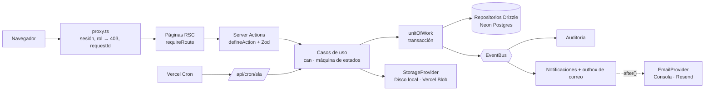

# Mesa de Ayuda ExperTIC

Aplicación web para gestionar las **solicitudes de soporte** (tickets) de profesores y estudiantes
de ExperTIC, y las **tareas** que el docente ExperTIC y los auxiliares líderes asignan al equipo
de auxiliares. Interfaz en español (Colombia), fechas `dd/MM/yyyy`, hora de 12 h y zona
`America/Bogota`, con horario hábil y festivos colombianos para los plazos (SLA).

## Roles

| Rol                   | Qué hace                                                             | Registro                         |
| --------------------- | -------------------------------------------------------------------- | -------------------------------- |
| Estudiante / Profesor | Crea solicitudes, conversa, califica la atención                     | Se activa al confirmar el correo |
| Auxiliar              | Atiende solicitudes asignadas, trabaja sus tareas (Kanban)           | Requiere aprobación del admin    |
| Auxiliar líder        | Lo anterior + asigna y supervisa a su equipo, fija prioridad         | Requiere aprobación del admin    |
| Docente ExperTIC      | Panel de control, bandeja global, tareas, plantillas y SLA, reportes | Requiere aprobación del admin    |
| Administrador         | Usuarios, equipos, auditoría, ajustes, salud del sistema, "Ver como" | Lo crea la semilla               |

La matriz completa está en [docs/PERMISOS.md](docs/PERMISOS.md).

## Arquitectura

Monolito modular sobre Next.js 16 (App Router, Cache Components). Cada módulo separa
**dominio** (reglas puras y probadas), **aplicación** (casos de uso) e **infraestructura**
(Drizzle, almacenamiento, correo), y la UI solo llama casos de uso a través de acciones de servidor.



Patrones aplicados: Repository, Use Case, State Machine (tickets y tareas), Policy/RBAC
(`can()`), Observer (eventos → auditoría y notificaciones en la misma transacción), Strategy/Adapter
(almacenamiento y correo), Factory (formularios de solicitud generados desde la plantilla JSON),
DTO y Composition Root (`shared/kernel/container.ts`).

```
src/
  app/            rutas (auth), (app), api
  modules/        tickets · tasks · templates · users · reports · audit · notifications
    <módulo>/domain | application | infrastructure | ui
  shared/         auth, db (esquema, migraciones, semilla), kernel, email, storage, lib, ui
tests/            integración (PGlite) y e2e (Playwright)
docs/             especificación, decisiones, plan, diseño, base de datos, permisos
```

## Correr en local

Requisitos: Node 20+, pnpm 10, una base de datos Postgres (recomendado: una rama de Neon).

```bash
pnpm install
cp .env.example .env.local      # completa DATABASE_URL, BETTER_AUTH_SECRET, etc.
pnpm db:migrate                  # aplica drizzle/*.sql
pnpm db:seed --solo-catalogo     # base en blanco: catálogo + admin de SEED_ADMIN_*
# o, para explorar con datos ficticios: pnpm db:seed --reset
pnpm dev                         # http://localhost:3000
```

- `pnpm db:seed --reset` borra y vuelve a sembrar; `--solo-catalogo` carga solo categorías y SLA.
- En desarrollo los correos no se envían: salen en la consola y en `.data/correos/<correo>.json`
  (de ahí sacas el enlace de verificación). Los adjuntos van a `.data/archivos`.

### Usuarios de prueba (semilla)

Contraseña de todos: `ExperTIC-2026*`

| Rol              | Correo                                         |
| ---------------- | ---------------------------------------------- |
| Docente ExperTIC | `docente@expertic.test`                        |
| Auxiliar líder   | `lider1@expertic.test`, `lider2@expertic.test` |
| Auxiliar         | `aux1@expertic.test` … `aux6@expertic.test`    |
| Profesor         | `profesor1@expertic.test` …                    |
| Estudiante       | `estudiante1@expertic.test` …                  |

El administrador es el de `SEED_ADMIN_EMAIL` / `SEED_ADMIN_PASSWORD`. **Cambia esa contraseña
antes de publicar.**

## Scripts

| Script                                                      | Para qué                                                                |
| ----------------------------------------------------------- | ----------------------------------------------------------------------- |
| `pnpm dev` / `build` / `start`                              | Desarrollo, build de producción, servidor de producción                 |
| `pnpm typecheck`                                            | Genera tipos de rutas y corre `tsc`                                     |
| `pnpm lint` / `format`                                      | ESLint / Prettier (también en el pre-commit con husky)                  |
| `pnpm test`                                                 | Unitarias e integración con Vitest (PGlite, sin red)                    |
| `pnpm test:e2e`                                             | Playwright contra `next start` (requiere `pnpm build` y la BD sembrada) |
| `pnpm db:generate` / `db:migrate` / `db:seed` / `db:studio` | Drizzle                                                                 |
| `pnpm tsx scripts/permisos-md.ts`                           | Regenera `docs/PERMISOS.md` desde el código                             |

Antes de cerrar un cambio: `pnpm typecheck && pnpm lint && pnpm test` y `pnpm build`.

## Agregar un tipo de solicitud

Sin tocar código: **Panel → Plantillas y SLA → Nueva categoría**. Eliges nombre, ícono, color,
prioridad por defecto y los campos (texto, número, fecha, selección, archivo…, con
obligatoriedad y ayudas); la vista previa muestra el formulario tal como lo verá el solicitante.
El mismo JSON genera el formulario y su validación Zod (`TicketFormFactory`), así que el servidor
valida exactamente lo que la pantalla pide. Para que una categoría nueva exista también en
instalaciones nuevas, agrégala a `src/shared/db/seed/catalog.ts`.

## Despliegue (GitHub + Vercel)

1. **GitHub:** crea un repositorio privado y sube la rama `main`
   (`git remote add origin … && git push -u origin main`).
2. **Vercel → Add New → Project**, importa el repositorio (detecta Next.js y pnpm).
3. **Base de datos:** en el proyecto de Vercel, _Storage → Neon_ (o _Integrations → Neon_) y
   conecta el proyecto de Neon. La integración crea `DATABASE_URL` y `DATABASE_URL_UNPOOLED`
   (y una rama por cada Preview si lo activas).
4. **Archivos:** _Storage → Blob → Create_ (privado). Agrega `STORAGE_DRIVER=vercel-blob`; el
   token `BLOB_READ_WRITE_TOKEN` lo pone la integración.
5. **Correo:** crea una cuenta en Resend, verifica tu dominio y agrega `EMAIL_DRIVER=resend`,
   `RESEND_API_KEY` y `EMAIL_FROM="Mesa de Ayuda ExperTIC <soporte@tu-dominio>"`.
6. **Resto de variables** (Production y Preview): `BETTER_AUTH_SECRET` (`openssl rand -base64 32`),
   `BETTER_AUTH_URL` y `NEXT_PUBLIC_APP_URL` con la URL pública, `CRON_SECRET` (16+ caracteres),
   `SEED_ADMIN_EMAIL`, `SEED_ADMIN_PASSWORD` y, si quieres restringir, `ALLOWED_EMAIL_DOMAINS`.
   **No** pongas `E2E_RELAXED_RATE_LIMIT` en producción (la app no arranca si lo haces).
7. **Migrar y sembrar** contra la base de producción, desde tu equipo con las variables de
   producción: `pnpm db:migrate && pnpm db:seed --solo-catalogo` (más el admin). No uses `--reset`.
8. **Cron:** `vercel.json` ya programa `/api/cron/sla` a diario (plan Hobby: una vez al día;
   con Pro puedes ponerlo cada hora). Vercel envía `CRON_SECRET` como token.
9. **Dominio:** _Settings → Domains_, agrega el dominio y crea el registro DNS que indique
   Vercel. Actualiza `BETTER_AUTH_URL` y `NEXT_PUBLIC_APP_URL` y vuelve a desplegar.
10. Verifica `https://tu-dominio/api/health` y entra con el admin.

## Puesta en marcha con datos reales

La base arranca **en blanco**: solo el administrador y el catálogo (6 categorías, SLA y ajustes).
`pnpm db:seed --solo-catalogo` la deja así; con `--reset` además borra todo lo anterior.

1. **Entra como administrador** (`SEED_ADMIN_EMAIL`) y cambia la contraseña en _Perfil_.
2. **Crea las cuentas del equipo** en _Administración → Usuarios → Crear cuenta_: los docentes
   ExperTIC con rol _Docente ExperTIC_ y los auxiliares con rol _Auxiliar_ o _Auxiliar líder_.
   Quedan activas de inmediato y cada persona recibe un correo para elegir su contraseña
   (requiere el correo de producción configurado, paso 5 del despliegue).
3. **Arma los equipos** en _Administración → Equipos_: nombre, líder y auxiliares.
4. **Revisa las categorías y los SLA** en _Panel → Plantillas y SLA_ (como docente).
5. **Invita a estudiantes y profesores** a registrarse en `/registro`. Su cuenta se activa al
   confirmar el correo, sin aprobación. Si alguien se registra como auxiliar, líder o docente,
   la cuenta queda pendiente hasta que el administrador la apruebe en _Usuarios_.

Los usuarios de prueba (`*@expertic.test`) existen solo si cargas la demostración con
`pnpm db:seed --reset` en una base de desarrollo; las pruebas E2E los necesitan. No la cargues
en la base de producción (el script lo impide).

## Documentación

- [docs/PROMPT_MAESTRO.md](docs/PROMPT_MAESTRO.md): especificación.
- [docs/DECISIONES.md](docs/DECISIONES.md): decisiones que la ajustan (prevalecen).
- [docs/PLAN.md](docs/PLAN.md): fases y estado.
- [docs/DISENO.md](docs/DISENO.md): sistema visual. [docs/BASE_DE_DATOS.md](docs/BASE_DE_DATOS.md): modelo de datos.
- [docs/PERMISOS.md](docs/PERMISOS.md): matriz de permisos.
